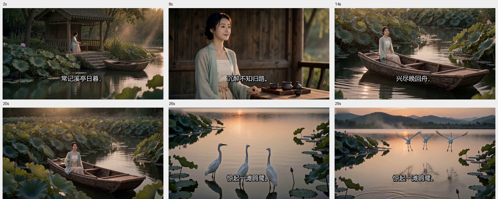
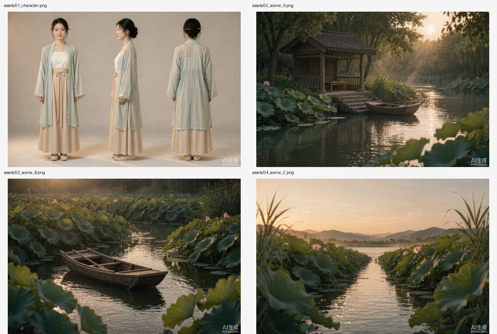

# 古诗词 → Seedance 2.5 浪漫短片｜全自动技能

输入一个诗名（或一句诗、或全诗），自动交出一支 30 秒东方美学短片 MP4。

> 📦 **分享版**：安装见 [INSTALL.md](INSTALL.md)（含一键安装脚本与完整中文说明）；
> 在线效果演示见 [DEMO 首页](https://iithink88.github.io/poem-to-seedance-film/)。

---

## 效果预览 · DEMO

以下全部由本技能一次跑通李清照《如梦令·常记溪亭日暮》**真实生成**，未做人工修饰。

**▶ [在线播放 30 秒成片（GitHub Pages）](https://iithink88.github.io/poem-to-seedance-film/)　·　[直接下载 MP4](docs/demo/ru-meng-ling-30s.mp4)**

[](https://iithink88.github.io/poem-to-seedance-film/)

*成片抽帧：2s / 8s / 14s / 20s / 26s / 29s。溪亭日暮 → 沉醉忘归 → 兴尽回舟 → 误入荷塘 → 拨叶寻路 → 惊起鸥鹭，含原词朗读与烧录中文字幕。*

### 自动生成的 4 张参考资产



*左上：同一人物正面 / 左侧面 / 背面三视图；其余：临水溪亭、荷塘木舟、开阔浅水。三视图 + 场景定样图是整支短片人物与场景不崩的关键。*

> ⚠️ **如实说明**：本页这支成片由平台内置视频后端（`minimax-video-h3`）分两段 15s 生成后自动拼接，**不是 Seedance 2.5 直出**。
> 本仓库同时提供完整合规的 30 秒 Seedance 2.5 提示词，可直接用于即梦 / 火山方舟控制台；
> 配置 `ARK_API_KEY` 后技能会自动走真 `doubao-seedance-2-5-260628` 一次直出。详见下方「两种视频后端」。

---

## 一句话用法

在 WorkBuddy 里直接说：

> 把《山居秋暝》做成古诗词短片

或

> 用「月落乌啼霜满天，江枫渔火对愁眠」做一支浪漫短片

或

> 春江潮水连海平，海上明月共潮生。滟滟随波千万里，何处春江无月明！ → 生成短片

全程不再提问，直接生成。

---

## 它会自动做完这 7 件事

| 阶段 | 做什么 | 产物 |
|---|---|---|
| 1 | 校订原文、判断题材情绪、自动选美学预设 | `spec.json` |
| 2 | 生成六镜分镜表（严格保持原诗事件顺序与情绪弧线） | `分镜表.md` |
| 3 | 生成主角三视图 + 3 张场景定样图的提示词，并**自动出图** | `prompts/01~04`、`assets/*.png` |
| 4 | 组装符合 Seedance 2.5 官方规范的 `@图片N` 多图参考提示词（30 秒连贯直出） | `prompts/05_...30s.txt` |
| 5 | 自动生成视频（含 30s → 2×15s 自动降级） | `video/raw.mp4` |
| 6 | 自动朗读原词、烧中文字幕、配无版权古风氛围音乐、拼接合成 | `成片_<诗名>.mp4` |
| 7 | 抽帧质检 + 交付报告 | `post_report.json` |

---

## 两种视频后端

| | 火山方舟直连（推荐） | 平台内置视频生成（零配置） |
|---|---|---|
| 模型 | **真·`doubao-seedance-2-5-260628`** | 实测 `minimax-video-h3`，**不是 Seedance 2.5、不可指定** |
| 前置 | 设置 `ARK_API_KEY`，且账户已开通 Seedance 2.5（余额 > 200 元 / 节省计划 / 资源包） | 无需任何配置 |
| 时长 | 30s 一次连贯直出 | **单次 4–15s**，实测走 2×15s 分段 + 自动拼接成 30s |
| 分辨率 | 480p / 720p / 1080p | 仅 `768P` / `2K`（`1080p` 报错；2K+15s 实测超时，用 `768P`） |
| 提示词 | 完整版约 2870 字 | **≤ 2000 字符**，自动用精简版 `08/09/10` |
| 音频 | `generate_audio=false`，声音全部后期做 | 模型强制带音频，后期会丢弃原声换成朗读+BGM |
| 角标 | `watermark=false` 无角标 | 左上角有平台角标，后期 `--delogo` 去除 |
| 计费 | 按火山方舟计费 | 约 300–600 积分（生图另约 20–40 积分） |

**自动判断**：检测到 `ARK_API_KEY` 就走方舟；没配或方舟失败，自动回退到内置生成，并在报告里如实注明「模型不可指定、非 Seedance 2.5、分段生成」。
**完整版 Seedance 2.5 提示词仍可直接复制到即梦 / 方舟控制台使用**，内置后端只是本机零配置的兜底通道。

设置 key（PowerShell，仅当前会话有效，不写入文件）：
```powershell
$env:ARK_API_KEY="你的 API Key"
```

---

## 「超级美丽 + 浪漫感」是怎么保证的

不是靠一句「唯美」，而是把美学规则写成**硬约束**注入每一条提示词：

- **写实电影**：真实皮肤/木纹/水波/布料褶皱，禁插画、游戏 CG、3D 建模感
- **通透不浓艳**：柔亮低角度侧逆光 + 面部柔和补光，绿植保持深橄榄绿、衣料保持奶白浅青，**不整体染成浓重橙黄**
- **含蓄不煽情**：一镜一个主动作，只有微风、碎发、衣袖、涟漪、飞絮；禁夸张表情与花哨转场
- **官方踩坑加固**：人物为正常人眼不发光（防 Seedance 2.5 瞳孔发光）、道具静止声明（防「船桨自己划」）、不复制三视图白底拼板
- **6 套诗风预设**：宋韵婉约 / 山水田园 / 羁旅夜泊 / 寒江孤绝 / 月夜怀人 / 豪放江河，按诗词情绪自动选，不是所有诗都套同一个宋韵模板

---

## 目录结构

```
poem-to-seedance-film/
├── SKILL.md                        # Agent 执行手册（全自动流程 + 精确参数）
├── README.md                       # 本文件
├── references/
│   ├── style-bible.md              # 美学圣经：铁律 / 风格块 / 6 套预设 / 骨架 / 踩坑 / 尾句
│   ├── seedance25-spec.md          # Seedance 2.5 官方规范 + API 速查 + 回退映射
│   ├── spec-schema.md              # spec.json 字段规范与自检清单
│   ├── poem-library.md             # 20 首常见诗词原文速查
│   └── golden-prompts.md           # 公众号原文完整提示词（逐字保留）
├── examples/如梦令_spec.json        # 完整黄金 spec，可直接改
└── scripts/
    ├── validate_spec.py            # spec 校验
    ├── build_prompts.py            # spec → 7 条提示词 + 分镜表 + 字幕 + manifest
    ├── register_assets.py          # 生成图归位
    ├── seedance25_api.py           # 火山方舟直连（含 --dry-run）
    └── finalize.py                 # 朗读 + 字幕 + BGM + 拼接 → 成片
```

---

## 手动分步（调试 / 只出提示词）

```bash
PY="python3"                                    # Windows 可填 WorkBuddy 托管 venv 的 python.exe
S="$HOME/.workbuddy/skills/poem-to-seedance-film"   # 技能安装目录
P="<项目目录>"

# 只生成全套提示词，不消耗任何积分
"$PY" "$S/scripts/validate_spec.py" "$P/spec.json"
"$PY" "$S/scripts/build_prompts.py" "$P/spec.json" --out "$P"

# 预览方舟请求体（不发送）
"$PY" "$S/scripts/seedance25_api.py" --project "$P" --dry-run

# 视频已生成后单独重做后期
"$PY" "$S/scripts/finalize.py" --project "$P" --voice zh-CN-YunxiNeural
```

---

## 常见问题

**Q：一定要 API Key 吗？**
不用。没 key 也能全自动出片，只是视频模型由平台决定、不保证是 Seedance 2.5。提示词本身仍是完整合规的 Seedance 2.5 提示词，可复制到即梦 / 方舟控制台使用。

**Q：为什么一定要三视图？**
原文实测：一张人物图 + 一张场景图直接生成视频必崩，切镜时人物和场景完全不一致。三视图 + 3 张场景定样图 + 一次 30 秒直出，是目前最稳的一致性方案。

**Q：为什么生成期没有朗读、配乐和字幕？**
Seedance 2.5 对台词/字幕容易过度响应（诱发自动字幕、瞳孔发光）。所以生成期一律「无对白、无旁白、无 BGM、无字幕」，朗读、字幕、氛围音乐全部放到后期 ffmpeg 阶段，反而更可控。

**Q：抽卡不稳定怎么办？**
这是模型固有现象，原文作者也说「一发入魂的概率挺玄」。技能内置了重试、2×15s 降级、字幕/配音降级；成片请抽帧检查，报告里会如实列出瑕疵，不伪装成功。

**Q：能用自己的主角图吗？**
可以。把 4 张图放进一个目录（顺序：人物 / 场景A / 场景B / 场景C），执行
`register_assets.py --project <项目目录> --from <图片目录>`，跳过阶段 3 即可。

**Q：会长诗塞满 30 秒吗？**
不会。超过 8 句自动取最有画面感的 4–6 句做节选，并在分镜表里注明。

---

## 已知限制（如实说明）

1. 内置视频生成工具**没有 model 参数**，实测落到 `minimax-video-h3`（不是 Seedance 2.5）：单次最长 15s、prompt ≤2000 字、分辨率只支持 `768P`/`2K`、强制带音频、左上角带角标。技能已自动用精简提示词 + 2×15s 分段 + 去角标适配；严格要 30s 一次连贯直出的 Seedance 2.5，请配 `ARK_API_KEY`。
2. 火山方舟视频下载 URL **只保留 24 小时**，`seedance25_api.py` 已自动下载，请尽快做后期。
3. 1080p 输出为 10bit H.265，后期会重编码为 H.264 8bit 以保证兼容性，有轻微画质损失。
4. 生图工具当前只暴露 `1536x1024` 等比例，参考图为 3:2，但因走「参考图」而非「首帧」模式，输出仍按参数锁定 16:9。
5. 氛围音乐是程序化合成的简单五声音阶垫音，不是真实古琴录音（目的是无版权、零依赖）。
6. 朗读音色来自 edge-tts（需联网）；无网络时自动跳过朗读，保留字幕与成片。

---

## 安装（30 秒）

1. 把本目录整个放到 `~/.workbuddy/skills/poem-to-seedance-film/`（Windows：`%USERPROFILE%\.workbuddy\skills\...`），
   或直接运行 `install.ps1` / `install.sh`。
2. 确认 Python 3.10+ 装了 `numpy` / `pillow` / `edge-tts`，且 `ffmpeg`（带 libass）在 PATH 中。
3. 重启 WorkBuddy，说一句「把《山居秋暝》做成古诗词短片，先只给提示词」验证。

完整说明、依赖检查、常见问题与跨平台字体设置见 **[INSTALL.md](INSTALL.md)**。

---

## 来源、许可与安全

- 制作流程与 `references/golden-prompts.md` 中的原始提示词来自公众号 **「挖挖说AI」**
  《实测 Seedance 2.5 制作古诗词 AI 短片，有点浪漫！（附完整提示词）》，版权归原作者，仅作学习交流引用，请勿商用。
- Seedance 2.5 规范整理自火山方舟官方文档。
- 脚本代码采用 MIT 许可，详见 `LICENSE`；`docs/demo/` 中的图片与视频由 AI 模型生成，仅供效果展示。
- **本仓库不含任何 API Key、Token 或凭据**。文档里出现的 `ARK_API_KEY` 等均为环境变量名或占位符；
  请勿把真实密钥写进文件、提交到 Git 或附在分享包里。
